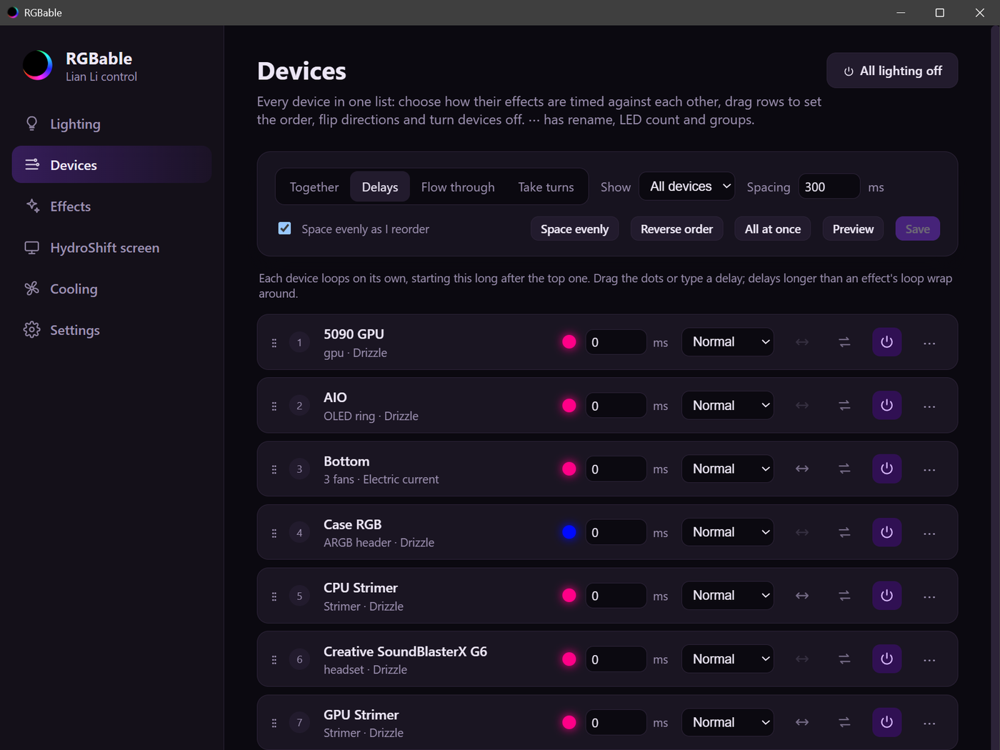
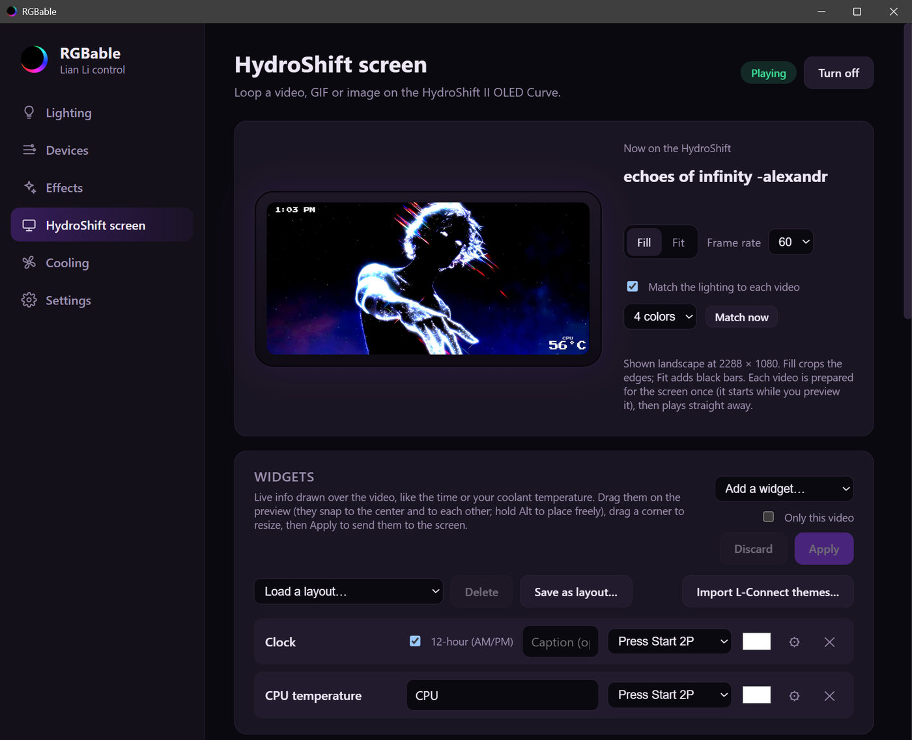
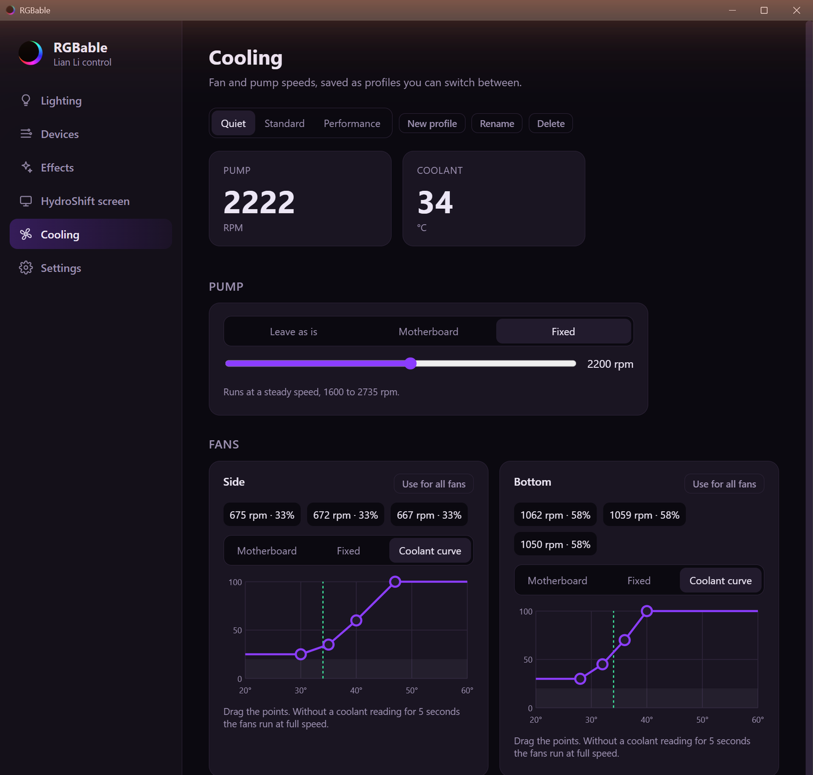

<h1 align="center">RGBable</h1>

<p align="center">
  An open-source L-Connect alternative for Windows.<br>
  Lian Li lighting and fans, the HydroShift OLED screen and the rest of your RGB in one app.
</p>

<p align="center">
  <a href="https://github.com/boywholifts/rgbable/releases/latest">Download</a> ·
  <a href="https://github.com/boywholifts/rgbable/releases">All releases</a> ·
  <a href="crates/lianli-app/CHANGELOG.md">Changelog</a> ·
  <a href="docs/rgbable/troubleshooting.md">Troubleshooting</a>
</p>


RGBable is unofficial and not affiliated with Lian Li. It is built on [lian-li-linux](https://github.com/sgtaziz/lian-li-linux) by sgtaziz, which did the hard work of decoding Lian Li's USB and wireless protocols.

## What it does

**Lighting**
- Lian Li wireless UNI FAN SL fans (SL V4, SL Flex and other SL Wireless models) and wireless Strimers through the Lian Li wireless receiver, plus the HydroShift II OLED Curve's ambient ring.
- Wired Lian Li gear over USB: Galahad II LCD and UNI HUB controllers *(new, still being tested)*.
- RAM, GPU, motherboard, ARGB headers, keyboards, monitors and anything else [OpenRGB](https://openrgb.org) supports. RGBable runs OpenRGB for you in the background.
- 20+ effects (breathing, rainbow wave, meteor, fire, aurora, ripple, starry night and more), L-Connect's own Lian Li effects, keyboard effects drawn on the key grid, and your own effects built from layers, a recipe builder or a short script.
- **All Devices** (one effect or color for the whole build), **groups**, and a **Devices** page to time devices against each other: together, staggered, flowing through the build like one strip, or taking turns. Each device keeps its own direction and speed, also through All Devices.
- **Lighting profiles**: save every device's lighting (and optionally the screen video) and switch with one click.
- **Off switches**: turn a single device off, or all lighting at once from the Lighting page, the Devices page, the profile menu or the tray. Each device keeps its lighting for when it's back on.
- Match the lighting to the colors of the video on the OLED screen.

**HydroShift OLED screen**
- Loop videos, GIFs and images, with a live preview and a library shared with [OLEDable](https://github.com/boywholifts/oledable).
- Widgets drawn over the video: clock, CPU/GPU temperature and load, coolant, pump and fan speed, bars, text and images.
- Import L-Connect screen themes, including their animated overlays.

**Cooling**
- Fan profiles with fixed speeds or coolant curves for wireless fans, and pump speed for the HydroShift.
- Pump speed, coolant temperature and fan RPM at a glance.

**App**
- Tray app that starts with Windows, restores your lighting and screen, and updates itself from GitHub Releases (Stable or Dev channel).
- First-run setup wizard that blinks each device so you can name, group and sync it.

<p align="center">
  
  
</p>
<p align="center">
  
</p>

## Install

1. Download `RGBable_x.y.z_x64-setup.exe` from the [latest release](https://github.com/boywholifts/rgbable/releases/latest) and run it. It installs for your user only.
2. Quit L-Connect and turn off its "start with Windows". Only one program can talk to the Lian Li devices at a time; RGBable waits until L-Connect has closed.
3. Lian Li devices need the WinUSB driver that L-Connect installs. If you've used L-Connect on this PC, it's already there.
4. For non-Lian Li lighting, install [OpenRGB](https://openrgb.org) as a normal app (not as a Windows service). In RGBable, open **Settings → OpenRGB** and turn on **Run OpenRGB for me**: RGBable starts it as administrator in the background and installs the PawnIO driver RAM lighting needs. One administrator prompt sets this up.
5. For the OLED screen, install FFmpeg: `winget install Gyan.FFmpeg`.

Builds aren't code-signed yet, so Windows SmartScreen may warn the first time. Click **More info → Run anyway**.

> **Coming from L-Connect, SignalRGB or another RGB app?** Only one program should control each light. Turn off the other apps' "start with Windows", and make sure only **one** copy of OpenRGB runs. L-Connect's OpenRGB integration, an OpenRGB Windows service and OpenRGB's own "start at login" each start a separate copy. See [Troubleshooting](docs/rgbable/troubleshooting.md).

## Updates and versions

RGBable uses [semantic versions](https://semver.org). **Settings → Updates** picks the channel:

- **Stable**: tested releases (`v1.0.0`).
- **Dev**: an automatic build of every change (`v1.1.0-dev.12`). Untested.

Your settings live in `%APPDATA%\RGBable` and survive updates and reinstalls. The log is `%APPDATA%\RGBable\rgbable.log`; attach it when you report a problem.

## Building from source

Releases are built by [GitHub Actions](.github/workflows/rgbable-release.yml). To build locally on Windows you need Rust (the version in `rust-toolchain.toml`), CMake, NASM and Node.js:

```powershell
git clone --recurse-submodules https://github.com/boywholifts/rgbable
cd rgbable\crates\lianli-app
npx @tauri-apps/cli@^2 build
```

The app lives in [`crates/lianli-app`](crates/lianli-app): a Tauri 2 backend in `src/` and a plain HTML/CSS/JS interface in `ui/`. The device drivers are lian-li-linux's `lianli-devices`, `lianli-transport` and `lianli-shared` crates, made to build on Windows.

To release, run `crates\lianli-app\release.ps1 1.1.0 -Tag` and push the tag.

## Credits and license

- [lian-li-linux](https://github.com/sgtaziz/lian-li-linux) by sgtaziz: device protocols and drivers. Its Linux daemon and GUI are still in this repository, unchanged.
- [OpenRGB](https://openrgb.org): non-Lian Li lighting.

MIT. See [LICENSE](LICENSE).
