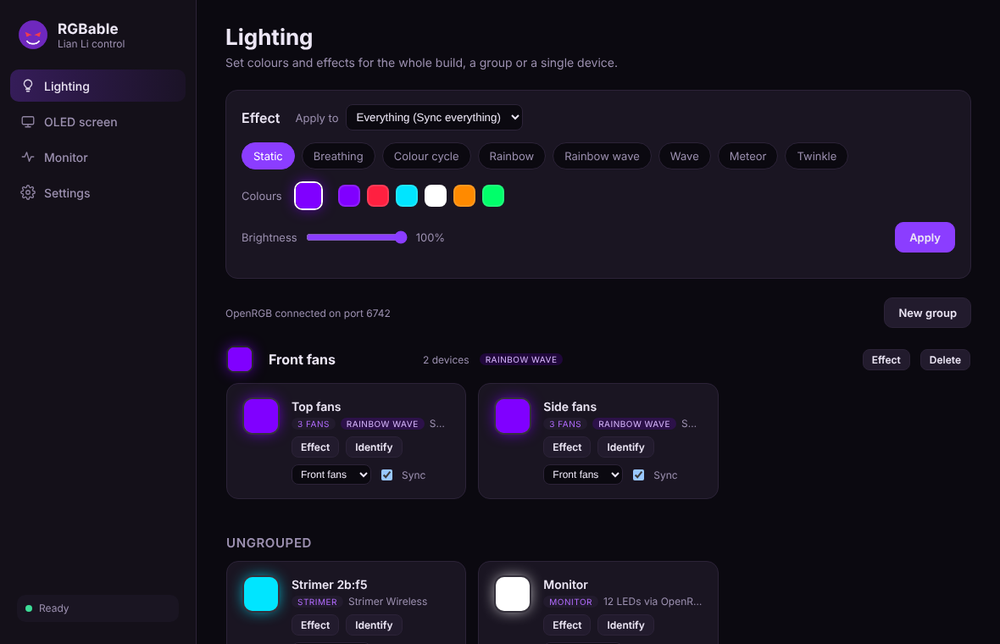
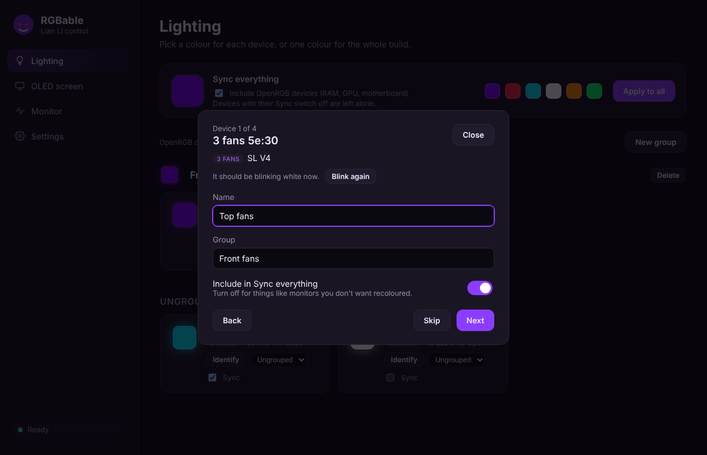

<h1 align="center">RGBable</h1>

<p align="center">
  An open-source L-Connect alternative for Windows.<br>
  Lian Li lighting, the HydroShift OLED screen and the rest of your RGB in one app.
</p>

<p align="center">
  <a href="https://github.com/boywholifts/rgbable/releases/latest">Download</a> ·
  <a href="https://github.com/boywholifts/rgbable/releases">All releases</a> ·
  <a href="crates/lianli-app/CHANGELOG.md">Changelog</a>
</p>



RGBable is unofficial and not affiliated with Lian Li. It is built on [lian-li-linux](https://github.com/sgtaziz/lian-li-linux) by sgtaziz, which did the hard work of decoding Lian Li's USB and wireless protocols.

## What it does

- **Lian Li lighting**: wireless UNI FAN SL fans (SL Flex and other SL V4/SL Wireless models) and wireless Strimers through the Lian Li wireless receiver, plus the HydroShift II OLED Curve's ambient ring.
- **Everything else**: RAM, GPU, motherboard, monitors and other RGB through [OpenRGB](https://openrgb.org) running in the background.
- **Effects**: breathing, colour cycle, rainbow, rainbow wave, wave, meteor and twinkle, with your colours, speed, brightness and direction. Wireless fans and Strimers store the effect and play it smoothly by themselves; the OLED ring and OpenRGB devices are animated live.
- **Sync everything**: one colour for the whole build (or one effect), with a per-device switch to leave things like a monitor alone.
- **Groups**: put devices in groups such as "Front fans" or "Desk", mixing Lian Li and OpenRGB devices, and colour a whole group at once. Drag devices between groups.
- **Identify**: blink any device white to see which one it is.
- **Setup wizard**: on first launch RGBable blinks each device in turn so you can name it, group it and choose whether Sync everything changes it.
- **HydroShift OLED screen**: loop a video, GIF or image on the HydroShift II OLED Curve.
- **Monitor**: pump speed, coolant temperature and fan RPM.
- **Tray app**: starts with Windows, restores your lighting and OLED, and updates itself from GitHub Releases (Stable or Dev channel).

Fan speed is left to your BIOS: fans connected to the motherboard's PWM header follow it.



## Install

1. Download `RGBable_x.y.z_x64-setup.exe` from the [latest release](https://github.com/boywholifts/rgbable/releases/latest) and run it. It installs for your user only, no admin needed.
2. Exit L-Connect and turn off its "start with Windows". Only one program can talk to the Lian Li devices at a time.
3. Lian Li devices need the WinUSB driver that L-Connect installs. If you've used L-Connect on this PC, it's already there.
4. For non-Lian Li lighting, install [OpenRGB](https://openrgb.org), open **SDK Server**, click **Start Server** and set OpenRGB to start minimised at login.
5. For the OLED screen, install FFmpeg: `winget install Gyan.FFmpeg`.

Builds aren't code-signed yet, so Windows SmartScreen may warn the first time. Click **More info → Run anyway**.

## Updates and versions

RGBable uses [semantic versions](https://semver.org). Settings → Updates picks the channel:

- **Stable**: tested releases (`v0.2.0`).
- **Dev**: an automatic build of every change (`v0.3.0-dev.12`). Untested.

## Building from source

Releases are built by [GitHub Actions](.github/workflows/rgbable-release.yml). To build locally on Windows you need Rust (the version in `rust-toolchain.toml`), CMake, NASM and Node.js:

```powershell
git clone --recurse-submodules https://github.com/boywholifts/rgbable
cd rgbable\crates\lianli-app
npx @tauri-apps/cli@^2 build
```

The app lives in [`crates/lianli-app`](crates/lianli-app): a Tauri 2 backend in `src/` and a plain HTML/CSS/JS interface in `ui/`. The device drivers are lian-li-linux's `lianli-devices`, `lianli-transport` and `lianli-shared` crates, made to build on Windows.

To release, run `crates\lianli-app\release.ps1 0.3.0 -Tag` and push the tag.

## Credits and license

- [lian-li-linux](https://github.com/sgtaziz/lian-li-linux) by sgtaziz: device protocols and drivers. Its Linux daemon and GUI are still in this repository, unchanged.
- [OpenRGB](https://openrgb.org): non-Lian Li lighting.

MIT. See [LICENSE](LICENSE).
